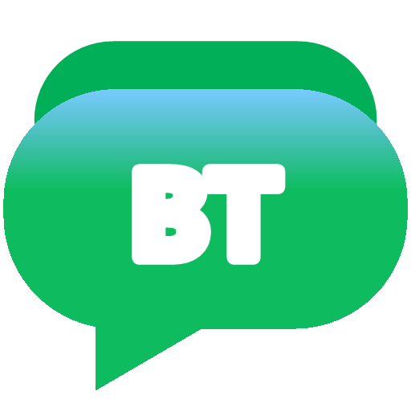

# ביטיצ'אט · BTChat



הצ'אטים של גוגל צ'אט בנגן אופליין: המחשב מחובר לגוגל צ'אט ומעביר לנגן בבלוטות' את הצ'אטים וההודעות, ובחזרה שליחה, תגובות, הודעות קוליות וסימון כנקרא.

<br clear="left">

## הורדה

- **האפליקציה לנגן:** [BTChat.apk](https://github.com/Xnet2/btchat/releases/latest/download/BTChat.apk)
- **התוכנה למחשב (Windows):** [BTChat-PC.zip](https://github.com/Xnet2/btchat/releases/latest/download/BTChat-PC.zip)

## מה יש בה

- רשימת צ'אטים ומרחבים בעיצוב של גוגל צ'אט (בהיר וכהה), עם חיפוש, "לא נקראו", וסרגל ניווט (בית, צ'אטים אישיים, מרחבים)
- בועות הודעה, ציטוט בתשובה (גם בהחלקה של הודעה הצידה), תגובות באימוג'י, שרשורים במרחבים
- עיצוב טקסט (מודגש, נטוי, קו תחתון, קו חוצה, קוד), עריכה ומחיקה של הודעות
- הודעות קוליות: האזנה עם גל קול ותמלול, והקלטה ושליחה מהנגן
- תמונות: טעינה לפי בקשה, וצירוף תמונה מהנגן
- כמה חשבונות גוגל, עם החלפה בלחיצה על תמונת הפרופיל
- התראות לכל צ'אט, עם תשובה מתוך ההתראה (אנדרואיד 7 ומעלה) וסימון כנקרא; השתקה לכל צ'אט
- כשהנגן מחוץ לטווח: בחיבור הבא המחשב שולח את מה שהנגן פספס
- עובד עם נטפרי, על אנדרואיד 4.4 ומעלה. התוכנה למחשב רצה על Windows 10/11 בלי התקנה (צריך Chrome או Edge)

## התקנה

1. **שיוך:** הנגן משויך למחשב בבלוטות' (הגדרות ← Bluetooth ומכשירים ← הוספת מכשיר).
2. **בנגן:** מתקינים את `BTChat.apk` ופותחים פעם אחת.
3. **במחשב:** מחלצים את `BTChat-PC.zip` ומפעילים את `BTChat.exe`. בפעם הראשונה נפתח חלון Chrome נפרד על גוגל צ'אט, ומתחברים בו לחשבון גוגל. אחר כך החלון מוסתר, והתוכנה מתחברת לנגן לבד.

## איך זה עובד

- התוכנה במחשב פותחת Chrome עם פרופיל משלה (`%LOCALAPPDATA%\BTChat\chrome`) ופורט פיתוח מקומי (9334), ומריצה את הבקשות לגוגל צ'אט מתוך הדף עצמו, עם החיבור של החשבון. החלון מוסתר לגמרי (גם משורת המשימות), ומופיע רק כשצריך להתחבר.
- כמה חשבונות: "הוספת חשבון" בתוכנה פותח את ההתחברות של גוגל באותו Chrome. כל חשבון מקבל כרטיסייה משלו (u/0, u/1…).
- (ל-Chrome הרגיל אי אפשר להתחבר מבחוץ בלי תוסף — Chrome חוסם את זה מ-2025.)
- הבקשות הן באותו פורמט JSON שאתר גוגל צ'אט משתמש בו (PBLite). נטפרי חוסמת את הפורמט הבינארי (`rt=b`), ולכן הוא לא בשימוש.
- הודעות חדשות: בדיקה של רשימת הצ'אטים כל 4 שניות כשהנגן מחובר, ולצ'אט שהשתנה מביאים את ההודעות האחרונות.
- הודעות קוליות הן קובצי m4a; הורדה והעלאה עוברות דרך Chrome, עם המשך וגל הקול כמו בהקלטה מגוגל צ'אט.
- החיבור הוא בלוטות' RFCOMM: הנגן מחכה לחיבור, והמחשב מתחבר אליו. כל הודעה היא שורת JSON.
- יומן תקלות במחשב: `%APPDATA%\BTChat\log.txt`.

## בנייה

```powershell
powershell -ExecutionPolicy Bypass -File pc\build.ps1
powershell -ExecutionPolicy Bypass -File android\build.ps1
```

הנגן נבנה עם ה-JDK וה-SDK שב-`%LOCALAPPDATA%\VODOS-build`, והמחשב עם `csc` של ‎.NET Framework שמגיע עם Windows.

בדיקות בלי נגן: `BTChat.exe /probe out.txt` ו-`BTChat.exe /sim out.txt <gid>` (מדמה נגן ומסכם מה היה נשלח, בלי תוכן הודעות).
